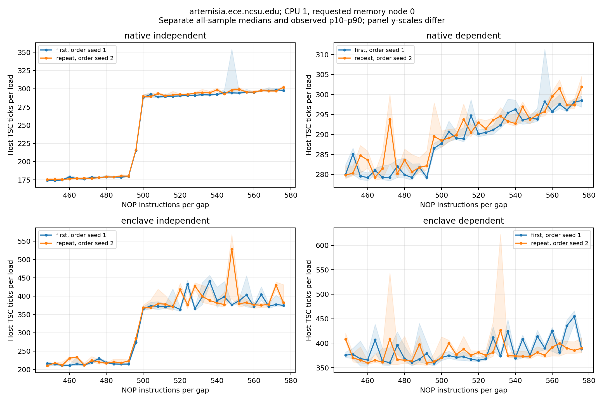

# Artemisia ROB-sensitive instruction-window results

**Measured finding:** independent-load overlap is lost near **500 NOP instructions per load-to-load gap**, with a repeatable transition across sampled N=492–500. Native and hardware-debug SGX show the same transition region at four-NOP resolution. SGX takes longer and exhibits greater timing variability. This supports an effective instruction-window limit under this kernel; an exact total ROB-entry count has not been established.

The current Artemisia measurement sequence is complete for this claim. No additional routine runs are proposed. The course's separate two-machine requirement remains outstanding.

## Mechanism and measurement

The shared assembly loop follows two independent randomized pointer rings, inserting N NOPs after each load. A dependent control serializes both loads through a single ring visiting the same full set of cache lines. With adequate instruction-window space, independent cache-miss latency can overlap. Increasing the spacing eventually prevents comparable overlap, bringing independent timing toward the serialized control.

Both builds link the same generated kernel object. Data setup is deterministic from pointer seed 42; the working footprint is 256 MiB, with stride 64. The main local native mapping uses verified 4 KiB backing on node 0. CPU 1 is fixed; EPC physical placement is not established. Each timed invocation executes 100,000 iterations and two pointer loads per iteration. Host LFENCE/RDTSCP timing includes native dispatch/return and, for SGX, the ECALL path. Units are **TSC ticks**, not active core cycles. Setup and warm-up are outside the timed bracket; cursors continue between samples.

## Replicated fine result

Two campaigns each contain 1,980 observations: 33 spacings (448..576, step 4), two modes, 15 samples per condition, two environments. Order seeds 1 and 2 change the condition order in fresh processes. Workload parameters, source build `bcd9d621feed36f6`, and all recorded binary hashes match. Each campaign is summarized separately, retaining every sample and applying no overhead subtraction.

Independent all-sample medians in host TSC ticks per load:

| NOPs per gap | Native first | Native repeat | SGX first | SGX repeat |
| ---: | ---: | ---: | ---: | ---: |
| 492 | 179.55 | 180.02 | 214.67 | 223.14 |
| 496 | 215.28 | 215.96 | 274.12 | 284.81 |
| 500 | 288.09 | 289.73 | 365.20 | 368.36 |

At N=500, independent/dependent median ratios are 1.001/1.004 natively and 0.985/0.994 in SGX, first/repeat respectively. The partial rise at 496 and near-convergence at 500 occur in both campaigns. Within each environment/campaign, every independent observation at 492 is below every observation at 496, and every observation at 496 is below every observation at 500. This separation is descriptive; it is not a confidence interval.



[PDF of fine comparison](results/v2-fine-repeat/review/comparison/curves.pdf) · [All selected raw transition samples](results/v2-fine-repeat/review/comparison/transition-samples.pdf) · [Detailed repeat review](results/v2-fine-repeat/review/REVIEW.md)

## What the controls establish

| Control | Observation and interpretation |
| --- | --- |
| Footprint calibration and repeat | 256 MiB provides a useful slow-load working baseline, distinct from the fast 16 KiB control. A footprint does not by itself prove that every timed load reaches DRAM. |
| Three pointer seeds and stride 64/128 | The coarse 480–512 feature survives these access-pattern changes. Stride also changes address span/translation, so it is not a pure prefetcher intervention. |
| Native page policy | A verified 4K/full-THP pair with both mappings on remote memory node 1 preserves the coarse feature. Full node-0 collapse failed; the earlier advice-only run had just 6/256 MiB THP and is inconclusive as a full page-size treatment. |
| NOP width and loop alignment | One-/two-byte NOPs and loop offsets 0/16/32 preserve the coarse feature at 256 MiB. The 16 KiB controls lack a comparable jump there. This tests instruction delivery without excluding all frontend effects or resolving shifts smaller than the coarse step. |
| Invocation overhead | SGX zero-work medians are about 10,760 total ticks. At 100,000 iterations this is a scale of about 0.054 ticks/load, much smaller than the coarse timing jump. Zero-work cost does not bound every cost of a nonzero invocation. |
| Fine repeat | The preselected 492–500 transition repeats despite changing condition order. SGX's other peaks do not provide reliable additional capacity boundaries. |

Per-stage raw evidence and reviews are under [calibration](results/v2-calibration-repeat/review/REVIEW.md), [pointer layout](results/v2-prefetch/review/REVIEW.md), [native remote page policy](results/v2-translation-node1/review/REVIEW.md), [frontend](results/v2-frontend/review/REVIEW.md), and [overhead](results/v2-overhead/review/REVIEW.md). These campaigns are controls with distinct configurations, not pooled repetitions of one treatment. The original v1 curves remain exploratory and separate from v2.

## Scope of the conclusion

The measured spacing is approximately 500 simple filler instructions per gap before overlap collapses. The loop contains **2N NOPs, two loads, one decrement and one conditional branch per iteration**; the wraparound gap includes loop control. Converting this measured spacing into total ROB entries requires justified instruction/uop and occupancy accounting, including possible coupled allocation limits. Neither a 500-entry nor a 1,004-entry ROB is established merely by reading the x-axis or counting the complete loop at N=500. The numerical 492–500 interval describes sampled NOP spacings, not a hardware-capacity confidence interval.

The repeated SGX run has a large isolated N=548 median peak that falls again at 552; its global largest median step is therefore 544→548, while its minimum-based largest step remains 496→500. This spike does not disappear from the unflagged-median diagnostic. It is retained with no unmeasured cause assigned. The replicated transition and full curve shape support the result; a largest-jump-only estimator would be misleading here.

Across the two fine campaigns, 3,960 samples include 16 observations with 115 minor-fault increments, zero major faults, zero migration tags, and 1,065 observations with context-switch deltas. Faults occur outside the selected 492/496/500 conditions. SMT sibling activity is uncontrolled; interrupts/AEX and frequency effects are incompletely observed. Native placement is verified at the snapshots, while EPC placement is unestablished. These are limits on attribution and exact capacity inference, not reasons to hide observations or require indefinite repetition.

## Reproduction and remaining work

Build, collection commands and timing semantics are documented in [ROB_BENCHMARK.md](ROB_BENCHMARK.md). To regenerate the fine analysis:

```bash
MPLCONFIGDIR=/tmp/rob-mpl python3 analysis/review_sweep.py results/v2-fine
MPLCONFIGDIR=/tmp/rob-mpl python3 analysis/review_sweep.py results/v2-fine-repeat
MPLCONFIGDIR=/tmp/rob-mpl python3 analysis/compare_sweeps.py \
  results/v2-fine results/v2-fine-repeat --samples-at 492 496 500
```

Comparison artifacts retain separate per-point statistics, global-step diagnostics, all selected raw samples, actual native mapping audits, workload/binary checks and evidence hashes. The next project work is to incorporate this supported result into the report and obtain the required independently validated result on another course machine. PRF and TLB experiments remain separate work. AI assistance and validation are recorded in [AI_USE_LOG.md](AI_USE_LOG.md).
